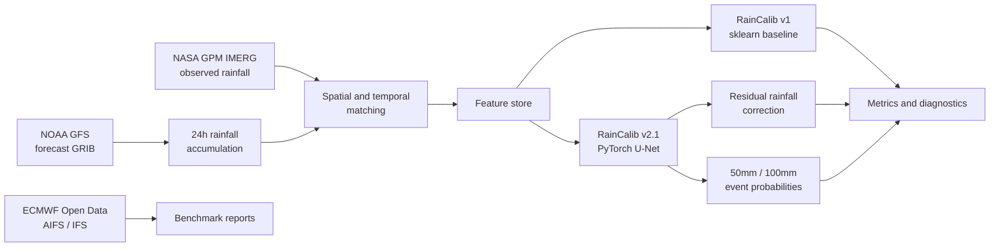

# RainCalib: Regional Heavy-Rainfall Forecast Calibration

RainCalib is an end-to-end research project for evaluating and post-processing heavy-rainfall forecasts over the middle and lower Yangtze River region. It downloads public meteorological data, computes 24-hour rainfall windows, benchmarks numerical weather prediction models against NASA GPM IMERG observations, and trains machine-learning correction models for NOAA GFS rainfall forecasts.

This is a research and decision-support project, not an official warning service.

## Portfolio Snapshot

| Area | What this project demonstrates |
|---|---|
| Meteorological data engineering | GFS / ECMWF / IMERG download planning, GRIB and NetCDF handling, 24h accumulation windows, coverage checks |
| Forecast verification | Rolling-origin evaluation, date-block bootstrap, continuous metrics, 50mm/100mm event scores, PR-AUC, BSS, and FSS |
| Machine learning | sklearn baseline, PyTorch U-Net residual correction, multi-task event head, weighted loss, balanced sampling |
| Model diagnostics | Lead-time, cycle, month, intensity-bin, spatial-grid, reliability, and case-study analysis |
| Reproducibility | Config-driven scripts, five-seed experiments, frozen protocol, tests, ignored local artifacts, restartable workflows |

## Superseded 00 UTC Revalidation

**Spatial-label correction (2026-09-29):** A real-data end-to-end check found that the legacy feature builder flattened IMERG longitude/latitude axes in the wrong order. The following 00 UTC results are also withdrawn. The half-hourly pipeline now rebuilds forecast grids and labels from raw data with explicit dimension ordering. See [plan 2 progress](docs/halfhourly_revalidation.md).

The earlier two-fold, five-seed evaluation retains 3,555 forecast fields. U-Net RMSE is **13.280 ± 0.138** versus Raw GFS **15.760** in rolling_2024, and **12.707 ± 0.208** versus **15.255** in rolling_2025. All 10 runs have favorable paired date-block 95% intervals against Raw GFS and quantile mapping.

These numbers no longer support a performance claim because of the spatial-label error. Mean RMSE does **not** beat grid-month climatology in either fold, and heavy-rainfall detection remains weak with high false-alarm rates. See [the revalidation record](docs/00utc_revalidation.md) and [full corrected results](docs/00utc_validation_results.md).

## Historical Mixed-Cycle Results — Superseded

**Correction (2026-09-29):** The numbers below used mixed 00/12 UTC forecasts with calendar-day IMERG labels. The 12 UTC windows were mismatched; these numbers and the previous internal acceptance claim are historical and must not be treated as validated conclusions. Default configs now use only 00 UTC and separate ml_00utc / experiments_00utc artifacts. See [the revalidation record](docs/00utc_revalidation.md).

The previous validation protocol used two rolling-origin folds, five fixed random seeds, and 1,000 paired bootstrap resamples of complete observed dates. It reported the following results, now retained for historical reference:

| Fold | Raw GFS MAE | RainCalib MAE | Raw GFS RMSE | RainCalib RMSE | Stable RMSE seeds |
|---|---:|---:|---:|---:|---:|
| rolling_2024 | 7.050 | 6.883 +/- 0.369 | 16.225 | 13.395 +/- 0.233 | 5/5 |
| rolling_2025 | 7.887 | 7.078 +/- 0.268 | 15.257 | 12.385 +/- 0.155 | 5/5 |

Heavy-rainfall event skill remains the main limitation:

| Fold | Event | CSI | POD | FAR | Raw FSS-5 | Event-head FSS-5 |
|---|---:|---:|---:|---:|---:|---:|
| rolling_2024 | 50 mm | 0.035 | 0.121 | 0.948 | 0.181 | 0.199 |
| rolling_2024 | 100 mm | 0.013 | 0.157 | 0.980 | 0.130 | 0.072 |
| rolling_2025 | 50 mm | 0.029 | 0.050 | 0.929 | 0.100 | 0.210 |
| rolling_2025 | 100 mm | 0.006 | 0.073 | 0.993 | 0.027 | 0.036 |

The previous mixed-cycle internal acceptance decision is withdrawn; the corrected 00 UTC evaluation is reported separately above. External and production acceptance remain pending until a complete untouched future period and an independent observation product are available. See [the experimental validation report](docs/experimental_validation_results.md) for baselines, uncertainty intervals, probability metrics, and limitations.

For a course-facing narrative report, see [the experimental course report](docs/experimental_course_report.md).

The earlier 2025-09-11 to 2025-09-30 development split produced MAE 7.049 and RMSE 13.084 for v2.1. It has been repeatedly inspected and is retained only as a development result, not a final holdout.

## System Overview



## Visual Diagnostics And Case Studies

Generated locally under `outputs/rainfall_benchmark/ml_00utc/figures/`:

- Lead-time skill curves for MAE and Bias.
- Observed-intensity diagnostics showing how the model behaves for light rain, moderate rain, and heavy-rain tails.
- Event-skill bar charts for Raw GFS, RainCalib v1, and RainCalib v2.1.
- Reliability diagrams before and after isotonic probability calibration.
- Case-study panels comparing IMERG target, Raw GFS, RainCalib corrected rainfall, error maps, and event-head probabilities.

Generate the visual report:

```bash
PYTHONPATH=src python scripts/create_raincalib_visual_report.py --config configs/raincalib_unet.yaml --split test --case-count 3
```

Generate the event calibration report:

```bash
PYTHONPATH=src python scripts/calibrate_raincalib_events.py --config configs/raincalib_unet.yaml --split test --tune-split val --far-cap 0.90
```

Local report paths:

```text
outputs/rainfall_benchmark/ml_00utc/reports/raincalib_unet_v21_test_visual_case_study.md
outputs/rainfall_benchmark/ml_00utc/reports/raincalib_unet_v21_test_event_calibration_report.md
```

These generated reports and figures are not committed because they are local experiment artifacts.

## Repository Contents

```text
configs/   Benchmark and RainCalib configuration files.
docs/      Project plans, experiment summaries, and result writeups.
scripts/   Download, coverage check, feature build, train, evaluate, calibrate, and diagnose entry points.
src/       Python package for data loading, regridding, metrics, reports, and ML utilities.
tests/     Unit and smoke tests.
```

## Quick Start

```bash
python -m venv .venv
source .venv/Scripts/activate
python -m pip install -r requirements.txt
PYTHONPATH=src python -m pytest -q
```

Run the default ECMWF-vs-IMERG benchmark:

```bash
PYTHONPATH=src python -m ai_weather_rainfall.cli --config configs/rainfall_benchmark.yaml
```

Run the GFS Plan A benchmark:

```bash
PYTHONPATH=src python -m ai_weather_rainfall.cli --config configs/gfs_rainfall_benchmark.yaml
```

## Data Layout

Place forecast and observation data under `outputs/rainfall_benchmark/raw/`:

- `ecmwf/aifs/` for AIFS forecast GRIB or NetCDF files.
- `ecmwf/ifs/` for IFS forecast GRIB or NetCDF files.
- `gfs/` for GFS forecast GRIB files containing cumulative APCP records.
- `imerg/` for IMERG precipitation files.

GFS and ECMWF accumulated precipitation must declare its units. The readers convert
metres to millimetres and accept millimetres or water mass per area (`kg m**-2`,
equivalent to millimetres). Missing, unknown, and rate units such as `mm/hr` raise
an error; integrate rates over their time intervals before using these readers.
ECMWF NetCDF inputs support `.nc`, `.nc4`, and `.netcdf` extensions.

The default ECMWF configuration uses the free Open Data window available for this project: 2025-05-01 through 2025-09-30. For a complete 2023-2025 historical ECMWF benchmark, use ECMWF Archive/MARS or another licensed archive.

The GFS configuration uses NOAA public archives for the 2023-2025 flood seasons. The downloader reads each `.idx` file and range-downloads only cumulative `APCP:surface:0-N day acc fcst` messages needed for 24-hour rainfall windows.

## Data Downloads

Run dry runs first:

```bash
PYTHONPATH=src python scripts/download_imerg_gesdisc.py --dry-run
PYTHONPATH=src python scripts/download_ecmwf_open_data.py --dry-run
PYTHONPATH=src python scripts/download_gfs_historical.py --config configs/gfs_rainfall_benchmark.yaml --dry-run
```

For GES DISC, put Earthdata credentials in `token.txt` or the `EARTHDATA_USERNAME` and `EARTHDATA_PASSWORD` environment variables, then run:

```bash
PYTHONPATH=src python scripts/download_imerg_gesdisc.py
```

Run a GFS smoke download and coverage check:

```bash
PYTHONPATH=src python scripts/download_gfs_historical.py --config configs/gfs_rainfall_benchmark.yaml --date 2025-09-01 --cycles 00 --retries 3
PYTHONPATH=src python scripts/check_gfs_coverage.py --config configs/gfs_rainfall_benchmark.yaml --date 2025-09-01 --sample-count 1
```

Run the full GFS Plan A batch:

```bash
PYTHONPATH=src python scripts/download_gfs_historical.py --config configs/gfs_rainfall_benchmark.yaml --retries 3
PYTHONPATH=src python scripts/check_gfs_coverage.py --config configs/gfs_rainfall_benchmark.yaml --sample-count 3
PYTHONPATH=src python -m ai_weather_rainfall.cli --config configs/gfs_rainfall_benchmark.yaml
```

## RainCalib Training

RainCalib v1 sklearn baseline:

Legacy feature labels must not be copied or filtered because of the confirmed spatial-axis error. Rebuild from raw data with the commands below; plan 2 uses its separate half-hourly pipeline.

```bash
PYTHONPATH=src python scripts/build_raincalib_features.py --config configs/raincalib.yaml --overwrite
PYTHONPATH=src python scripts/train_raincalib_baseline.py --config configs/raincalib.yaml
PYTHONPATH=src python scripts/evaluate_raincalib.py --config configs/raincalib.yaml --split test
```

RainCalib v2.1 U-Net:

```bash
conda activate raincalib-gpu
PYTHONPATH=src python scripts/build_raincalib_tensor_dataset.py --config configs/raincalib_unet.yaml --overwrite
PYTHONPATH=src python scripts/train_raincalib_unet.py --config configs/raincalib_unet.yaml
PYTHONPATH=src python scripts/evaluate_raincalib_unet.py --config configs/raincalib_unet.yaml --split test --tune-split val
PYTHONPATH=src python scripts/diagnose_raincalib_unet_errors.py --config configs/raincalib_unet.yaml --split test
PYTHONPATH=src python scripts/create_raincalib_visual_report.py --config configs/raincalib_unet.yaml --split test
PYTHONPATH=src python scripts/calibrate_raincalib_events.py --config configs/raincalib_unet.yaml --split test --tune-split val
```

Run the frozen rolling-origin experiment and acceptance workflow:

```bash
PYTHONPATH=src python scripts/audit_experiment_data.py
PYTHONPATH=src python scripts/run_statistical_validation.py
PYTHONPATH=src python scripts/run_unet_experiment_matrix.py
PYTHONPATH=src python scripts/recompute_unet_fss.py
PYTHONPATH=src python scripts/create_experimental_acceptance_report.py
PYTHONPATH=src python scripts/create_experimental_report_figures.py
```

Check GPU readiness:

```bash
python scripts/check_raincalib_gpu.py
```

The prepared local GPU conda environment is `raincalib-gpu`.

## Data And Artifacts

This repository tracks source code, configuration, tests, notebooks, and Markdown summaries only.

Do not commit:

- Raw forecast or observation files.
- Generated NetCDF, GRIB, HDF5, Parquet, NPZ, CSV metric bundles, plots, or reports under `outputs/`.
- Trained model weights such as `.pt` or `.joblib`.
- Credentials such as `token.txt`, `.earthdata.netrc`, or `.urs_cookies`.

The `.gitignore` file is configured to ignore these local data and artifact files. Reproduce them locally with the commands above.

## Documentation

- `docs/plan_a_gfs_imerg_raincalib.md`
- `docs/raincalib_results_summary.md`
- `docs/raincalib_deep_learning_plan.md`
- `docs/raincalib_v2_results_summary.md`
- `docs/experimental_protocol.md`
- `docs/experimental_validation_results.md`
- `docs/experimental_course_report.md`

## Roadmap

- Add calibrated operating modes for different alert goals: high recall, balanced CSI, and low false-alarm screening.
- Add more GFS physical predictors such as water vapor, winds, CAPE, relative humidity, and terrain.
- Add lead-specific calibration for long forecast horizons such as 240h and 360h.
- Add GitHub Actions and small synthetic fixtures for public CI.
