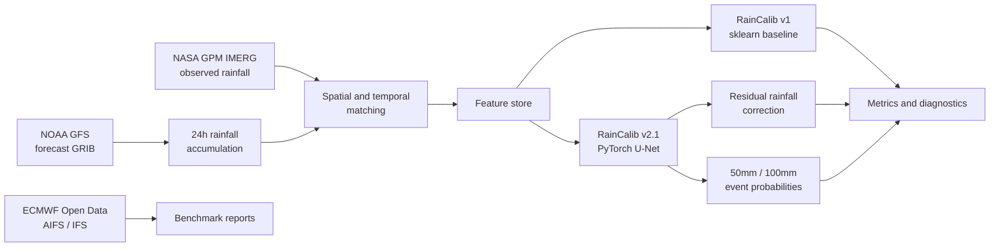

# RainCalib: Regional Heavy-Rainfall Forecast Calibration

RainCalib is an end-to-end research project for evaluating and post-processing heavy-rainfall forecasts over the middle and lower Yangtze River region. It downloads public meteorological data, computes 24-hour rainfall windows, benchmarks numerical weather prediction models against NASA GPM IMERG observations, and trains machine-learning correction models for NOAA GFS rainfall forecasts.

This is a research and decision-support project, not an official warning service.

## Portfolio Snapshot

| Area | What this project demonstrates |
|---|---|
| Meteorological data engineering | GFS / ECMWF / IMERG download planning, GRIB and NetCDF handling, 24h accumulation windows, coverage checks |
| Forecast verification | Continuous rainfall metrics plus 50mm/100mm event scores: MAE, RMSE, Bias, Pearson r, CSI, POD, FAR, ETS |
| Machine learning | sklearn baseline, PyTorch U-Net residual correction, multi-task event head, weighted loss, balanced sampling |
| Model diagnostics | Lead-time, cycle, month, intensity-bin, spatial-grid, reliability, and case-study analysis |
| Reproducibility | Config-driven scripts, tests, ignored local artifacts, restartable download and evaluation workflows |

## Key Results

Test split continuous rainfall skill:

| Model | MAE | RMSE | Bias | Pearson r |
|---|---:|---:|---:|---:|
| Raw GFS | 8.726 | 17.209 | -0.600 | 0.048 |
| RainCalib v1 sklearn | 7.785 | 13.363 | -0.335 | 0.132 |
| RainCalib v2 U-Net | 7.188 | 13.333 | -0.855 | 0.195 |
| RainCalib v2.1 U-Net | 7.049 | 13.084 | -0.751 | 0.241 |

RainCalib v2.1 event-head skill:

| Threshold | CSI | POD | FAR | ETS |
|---:|---:|---:|---:|---:|
| 50 mm | 0.060 | 0.489 | 0.936 | 0.043 |
| 100 mm | 0.011 | 0.043 | 0.985 | 0.009 |

Probability calibration with isotonic regression improves reliability and Brier score, but it is intentionally reported separately from high-recall event screening:

| Event | Raw Brier | Isotonic Brier | Operational note |
|---:|---:|---:|---|
| 50 mm | 0.0756 | 0.0187 | Raw event head is better for recall-oriented screening; calibrated probability is better for risk interpretation. |
| 100 mm | 0.0065 | 0.0021 | Calibration reduces overconfidence, while extreme-event detection remains data-limited. |

## System Overview



## Visual Diagnostics And Case Studies

Generated locally under `outputs/rainfall_benchmark/ml/figures/`:

- Lead-time skill curves for MAE and Bias.
- Observed-intensity diagnostics showing how the model behaves for light rain, moderate rain, and heavy-rain tails.
- Event-skill bar charts for Raw GFS, RainCalib v1, and RainCalib v2.1.
- Reliability diagrams before and after isotonic probability calibration.
- Case-study panels comparing IMERG target, Raw GFS, RainCalib corrected rainfall, error maps, and event-head probabilities.

Generate the visual report:

```bash
PYTHONPATH=src python scripts/create_raincalib_visual_report.py --config configs/raincalib_unet.yaml --split test --case-count 3
```

Generate the event calibration report:

```bash
PYTHONPATH=src python scripts/calibrate_raincalib_events.py --config configs/raincalib_unet.yaml --split test --tune-split val --far-cap 0.90
```

Local report paths:

```text
outputs/rainfall_benchmark/ml/reports/raincalib_unet_v21_test_visual_case_study.md
outputs/rainfall_benchmark/ml/reports/raincalib_unet_v21_test_event_calibration_report.md
```

These generated reports and figures are not committed because they are local experiment artifacts.

## Repository Contents

```text
configs/   Benchmark and RainCalib configuration files.
docs/      Project plans, experiment summaries, and result writeups.
scripts/   Download, coverage check, feature build, train, evaluate, calibrate, and diagnose entry points.
src/       Python package for data loading, regridding, metrics, reports, and ML utilities.
tests/     Unit and smoke tests.
```

## Quick Start

```bash
python -m venv .venv
source .venv/Scripts/activate
python -m pip install -r requirements.txt
PYTHONPATH=src python -m pytest -q
```

Run the default ECMWF-vs-IMERG benchmark:

```bash
PYTHONPATH=src python -m ai_weather_rainfall.cli --config configs/rainfall_benchmark.yaml
```

Run the GFS Plan A benchmark:

```bash
PYTHONPATH=src python -m ai_weather_rainfall.cli --config configs/gfs_rainfall_benchmark.yaml
```

## Data Layout

Place forecast and observation data under `outputs/rainfall_benchmark/raw/`:

- `ecmwf/aifs/` for AIFS forecast GRIB or NetCDF files.
- `ecmwf/ifs/` for IFS forecast GRIB or NetCDF files.
- `gfs/` for GFS forecast GRIB files containing cumulative APCP records.
- `imerg/` for IMERG precipitation files.

The default ECMWF configuration uses the free Open Data window available for this project: 2025-05-01 through 2025-09-30. For a complete 2023-2025 historical ECMWF benchmark, use ECMWF Archive/MARS or another licensed archive.

The GFS configuration uses NOAA public archives for the 2023-2025 flood seasons. The downloader reads each `.idx` file and range-downloads only cumulative `APCP:surface:0-N day acc fcst` messages needed for 24-hour rainfall windows.

## Data Downloads

Run dry runs first:

```bash
PYTHONPATH=src python scripts/download_imerg_gesdisc.py --dry-run
PYTHONPATH=src python scripts/download_ecmwf_open_data.py --dry-run
PYTHONPATH=src python scripts/download_gfs_historical.py --config configs/gfs_rainfall_benchmark.yaml --dry-run
```

For GES DISC, put Earthdata credentials in `token.txt` or the `EARTHDATA_USERNAME` and `EARTHDATA_PASSWORD` environment variables, then run:

```bash
PYTHONPATH=src python scripts/download_imerg_gesdisc.py
```

Run a GFS smoke download and coverage check:

```bash
PYTHONPATH=src python scripts/download_gfs_historical.py --config configs/gfs_rainfall_benchmark.yaml --date 2025-09-01 --cycles 00 12 --retries 3
PYTHONPATH=src python scripts/check_gfs_coverage.py --config configs/gfs_rainfall_benchmark.yaml --date 2025-09-01 --sample-count 1
```

Run the full GFS Plan A batch:

```bash
PYTHONPATH=src python scripts/download_gfs_historical.py --config configs/gfs_rainfall_benchmark.yaml --retries 3
PYTHONPATH=src python scripts/check_gfs_coverage.py --config configs/gfs_rainfall_benchmark.yaml --sample-count 3
PYTHONPATH=src python -m ai_weather_rainfall.cli --config configs/gfs_rainfall_benchmark.yaml
```

## RainCalib Training

RainCalib v1 sklearn baseline:

```bash
PYTHONPATH=src python scripts/build_raincalib_features.py --config configs/raincalib.yaml --overwrite
PYTHONPATH=src python scripts/train_raincalib_baseline.py --config configs/raincalib.yaml
PYTHONPATH=src python scripts/evaluate_raincalib.py --config configs/raincalib.yaml --split test
```

RainCalib v2.1 U-Net:

```bash
conda activate raincalib-gpu
PYTHONPATH=src python scripts/build_raincalib_tensor_dataset.py --config configs/raincalib_unet.yaml --overwrite
PYTHONPATH=src python scripts/train_raincalib_unet.py --config configs/raincalib_unet.yaml
PYTHONPATH=src python scripts/evaluate_raincalib_unet.py --config configs/raincalib_unet.yaml --split test --tune-split val
PYTHONPATH=src python scripts/diagnose_raincalib_unet_errors.py --config configs/raincalib_unet.yaml --split test
PYTHONPATH=src python scripts/create_raincalib_visual_report.py --config configs/raincalib_unet.yaml --split test
PYTHONPATH=src python scripts/calibrate_raincalib_events.py --config configs/raincalib_unet.yaml --split test --tune-split val
```

Check GPU readiness:

```bash
python scripts/check_raincalib_gpu.py
```

The prepared local GPU conda environment is `raincalib-gpu`.

## Data And Artifacts

This repository tracks source code, configuration, tests, notebooks, and Markdown summaries only.

Do not commit:

- Raw forecast or observation files.
- Generated NetCDF, GRIB, HDF5, Parquet, NPZ, CSV metric bundles, plots, or reports under `outputs/`.
- Trained model weights such as `.pt` or `.joblib`.
- Credentials such as `token.txt`, `.earthdata.netrc`, or `.urs_cookies`.

The `.gitignore` file is configured to ignore these local data and artifact files. Reproduce them locally with the commands above.

## Documentation

- `docs/plan_a_gfs_imerg_raincalib.md`
- `docs/raincalib_results_summary.md`
- `docs/raincalib_deep_learning_plan.md`
- `docs/raincalib_v2_results_summary.md`

## Roadmap

- Add calibrated operating modes for different alert goals: high recall, balanced CSI, and low false-alarm screening.
- Add more GFS physical predictors such as water vapor, winds, CAPE, relative humidity, and terrain.
- Add lead-specific calibration for long forecast horizons such as 240h and 360h.
- Add GitHub Actions and small synthetic fixtures for public CI.
